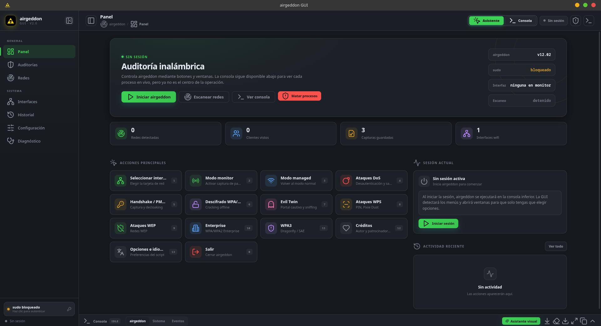
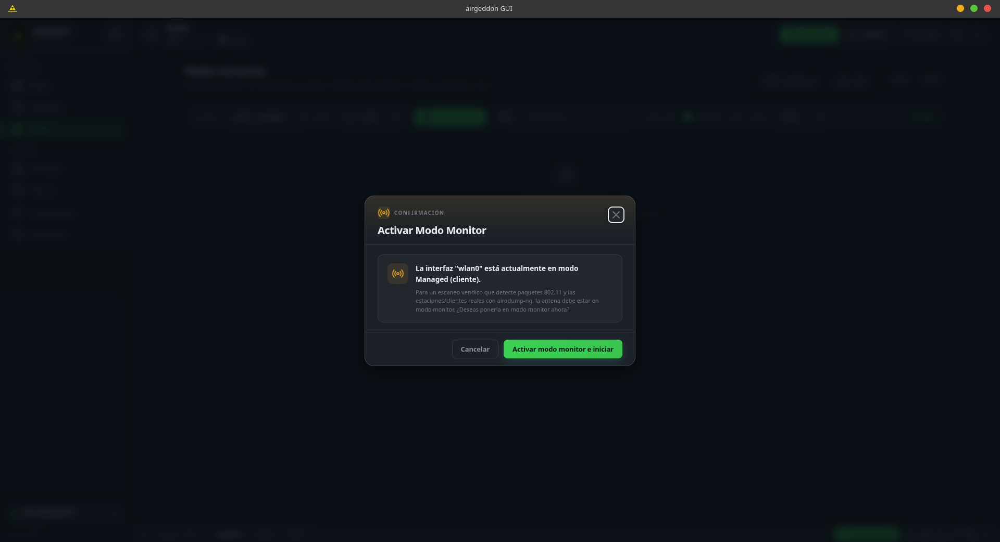
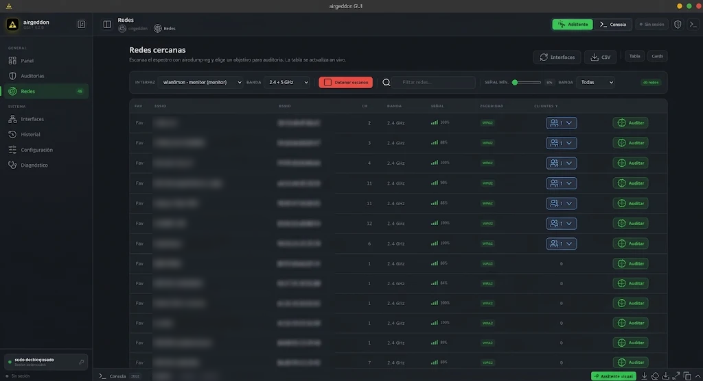
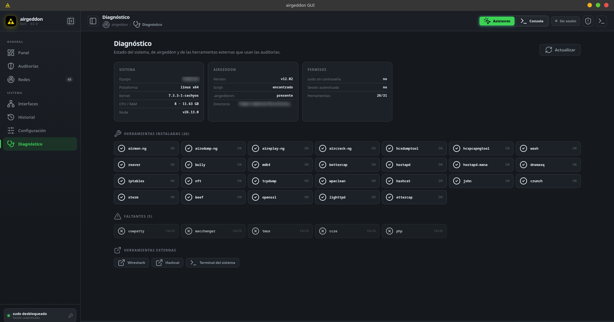

<div align="center">

# airgeddon GUI

**Interfaz gráfica de escritorio para [airgeddon](https://github.com/v1s1t0r1sh3r3/airgeddon) en Linux**

[Panel](docs/panel.png)

[](LICENSE)
[](https://nodejs.org/)
[](https://www.linux.org/)
[](https://github.com/v1s1t0r1sh3r3/airgeddon)
[](package.json)

</div>

---

## ¿Qué es esto?

**airgeddon GUI** es un *front-end* gráfico y una **aplicación de escritorio nativa para Linux** que envuelve a
[airgeddon](https://github.com/v1s1t0r1sh3r3/airgeddon), el script de auditoría inalámbrica de
[v1s1t0r1sh3r3](https://github.com/v1s1t0r1sh3r3).

airgeddon es un programa de consola brillante, pero exactamente lo contrario de un entorno hostil: hay que
memorizar atajos, interpretar menús en ASCII y tomar decisiones a ciegas. **airgeddon GUI** se coloca por delante
de esa terminal y la convierte en una experiencia visual: analiza la pantalla de airgeddon en tiempo real,
reconoce qué te está pidiendo y te lo presenta en tarjetas, tablas y formularios.

El resultado no es una simple ventana con un `iframe`: es una capa de **automatización de terminal** que lee el
búfer PTY, lo interpreta y reconstruye la interacción como interfaz gráfica nativa.

> ⚠️ **Uso responsable.** Esta herramienta está pensada exclusivamente para auditorías de seguridad en redes
> propias o sobre las que exista autorización formal y por escrito. Su uso contra redes de terceros sin
> consentimiento es **ilegal** en la mayoría de países. Eres tú el responsable del uso que hagas de ella.

---

## 📸 Capturas

<div align="center">

### Panel de control



### Asistente visual — confirmación de modo monitor



### Explorador y escáner de redes



### Diagnóstico del sistema



</div>

---

## ✨ Características

### 🖥️ Aplicación de escritorio nativa

- Se integra en el menú de aplicaciones del sistema (`~/.local/share/applications/airgeddon-gui.desktop`).
- **Ventana independiente**: sin barra de direcciones, sin pestañas, sin barra de herramientas.
- Icono propio multirresolución (16 → 256 px) en la barra de tareas, con `StartupWMClass` para que el botón
  `Alt + Tab` y el dock lo asocien correctamente.
- Gestiónor de contraseñas y avisos de notificaciones del navegador **desactivados** en el perfil dedicado.
- Sin modo web: la aplicación se abre siempre en su propia ventana de escritorio.

### 🤖 Asistente visual inteligente

Es el núcleo del proyecto. Un ciclo de **detectar → preguntar → responder**:

| Tipo de prompt | Qué hace la GUI |
|---|---|
| **Menú** | Convierte las opciones numeradas de airgeddon en tarjetas clicables con icono y descripción. Puedes teclear el número directamente. |
| **Redes** | Tabla o tarjetas con búsqueda, filtro por banda (2.4 / 5 / 6 GHz), señal mínima, 5 criterios de ordenación, desglose de clientes y botón **Auditar** por fila. |
| **Confirmación** | `[Y/n]` se convierte en una ventana con **Sí / No** y atajos de teclado (`y`, `s`, `n`, `Enter`). |
| **Entrada de texto** | Campo con el valor por defecto detectado en la pregunta. |
| **Contraseña de sudo** | Campo de contraseña con toggle de visibilidad, sin guardado automático. |
| **Continuar** | *"Pulsa Enter para continuar"*, clasificado automáticamente como **Error**, **Advertencia**, **Completado** o neutro. |

Además, el asistente **detecta y explica errores** antes de que se produzcan: si seleccionas una tarjeta cableada
(`enp2s0`) o una acción incompatible, te avisa con la causa y la solución en lugar de dejarte atascado.

### 💻 Consola PTY en vivo

- Terminal **xterm.js** embebida con la salida ANSI exacta de airgeddon.
- Búsqueda integrada (`Ctrl + F`), copiar selección, ajuste de tamaño de fuente (`Ctrl + +` / `Ctrl + -`).
- Auto-scroll inteligente: se detiene al subir manualmente y se reanuda al volver al final.
- **3 pestañas**: `airgeddon`, `Sistema` y `Eventos`, con descarga del log de sesión.

### 📡 Auditoría guiada

- **8 auditorías** predefinidas (Handshake/PMKID, DoS, Evil Twin, WPS, WEP, Descifrado WPA/WPA2, Enterprise, WPA3),
  cada una con sus pasos, sus tags y una guíamodal explicativa.
- Notas de campo, barra de progreso y **plantillas** de auditoría guardables y reutilizables.
- Las **14 acciones** del menú principal de airgeddon, siempre accesibles como botones.

### 📊 Escaneo de redes

- Escaneo nativo con `airodump-ng` en modo CSV, con actualización **en vivo** cada segundo.
- Asociación automática de **clientes/estaciones** a su punto de acceso.
- Conversión dBm → porcentaje de señal, detección de banda por canal/frecuencia y etiquetado de seguridad
  (WEP / WPA / WPA2 / WPA3 / Abierta).
- Favoritos, exportación a **CSV** y ordenación por señal, canal, seguridad, banda o clientes.

### 🔧 Diagnóstico del sistema

- Detección de **31 herramientas** de auditoría (instaladas / faltantes) y de sus versiones.
- Estado de airgeddon, de `.airgeddonrc`, del estado de `sudo` y del sistema.
- Estado de la interfaz en modo monitor, del escaneo y de las sesiones.

### 🛡️ Seguridad y privacidad

- El servidor hace **bind a `127.0.0.1`** únicamente: no es accesible desde la red.
- La contraseña de `sudo` **nunca se escribe en disco**: vive solo en la memoria RAM del proceso y se invalida al
  cerrar sesión (`POST /api/lock`).
- Se aplica una **Content-Security-Policy** estricta (`script-src 'self'`, `object-src 'none'`,
  `frame-ancestors 'none'`).
- La contraseña se enmascara (`••••••`) en toda la salida de la terminal y en el registro del sistema.

### 🔄 Actualizaciones integradas

- Comprobación y aplicación de actualizaciones **desde la interfaz** (Configuración → Comprobar → Actualizar).
- Empaquetado nativo: **`.deb`** para Debian / Ubuntu / Kali / Parrot y **PKGBUILD** para Arch / CachyOS / Manjaro.

---

## 🐧 Distribuciones soportadas

| Distribución | Gestor | Vía de instalación |
| :--- | :---: | :--- |
| **Debian**, **Ubuntu**, **Kali Linux**, **Parrot OS** | `apt` | `install.sh` o paquete `.deb` |
| **Arch Linux**, **CachyOS**, **Manjaro** | `pacman` | `install.sh` o `PKGBUILD` (`makepkg -si`) |
| **Fedora**, **RHEL**, **openSUSE** | `dnf` / `zypper` | `install.sh` |

El instalador `install.sh` detecta el gestor de paquetes automáticamente, por lo que funciona en las tres familias
sin cambios.

---

## 🚀 Instalación

### Opción A — Instalador interactivo (recomendada)

El instalador comprueba tus dependencias, te pregunta si ya tienes airgeddon (y si no, lo clona desde su fuente
oficial), instala las herramientas de auditoría que falten, instala las dependencias de Node y registra la
aplicación en tu menú.

```bash
git clone https://github.com/sjcandy/airgeddon-gui.git
cd airgeddon-gui
chmod +x install.sh
./install.sh
```

<details>
<summary><b>¿Qué hace exactamente?</b></summary>

1. Detecta el gestor de paquetes (`pacman`, `apt` o `dnf`).
2. Comprueba **Node.js ≥ 18** y **npm**; si faltan, te ofrece instalarlos (en Debian/Ubuntu añade el repositorio
   oficial de NodeSource 20).
3. Localiza una instalación previa de airgeddon o te permite indicar la ruta; si no hay ninguna, **clona
   `https://github.com/v1s1t0r1sh3r3/airgeddon.git`** automáticamente.
4. Comprueba las herramientas de auditoría (`aircrack-ng`, `xterm`, `iw`, `curl`) y el toolchain necesario para
   compilar `node-pty`.
5. Ejecuta `npm install`.
6. Genera los iconos multirresolución y el archivo `.desktop` de la aplicación.

</details>

### Opción B — Debian / Ubuntu / Kali / Parrot (paquete `.deb`)

```bash
git clone https://github.com/sjcandy/airgeddon-gui.git
cd airgeddon-gui

# Construir el paquete
./build-deb.sh

# Instalar
sudo apt install ./airgeddon-gui_2.0.0_all.deb
```

El `.deb` instala la aplicación en `/opt/airgeddon-gui`, crea el lanzador `/usr/bin/airgeddon-gui` y el acceso
directo `.desktop`, y compila las dependencias de Node en el `postinst`.

<details>
<summary><b>Dependencias del sistema en Debian / Ubuntu (si prefieres instalarlas antes)</b></summary>

```bash
sudo apt update
sudo apt install -y \
    nodejs npm git curl aircrack-ng xterm wireless-tools iw ccze iproute2 \
    build-essential python3 python3-pil

# airgeddon (proyecto original, GPLv3)
git clone https://github.com/v1s1t0r1sh3r3/airgeddon.git ~/airgeddon
```

</details>

### Opción C — Arch Linux / CachyOS / Manjaro (paquete `PKGBUILD`)

```bash
git clone https://github.com/sjcandy/airgeddon-gui.git
cd airgeddon-gui

# Construir e instalar el paquete
makepkg -si
```

El `PKGBUILD` es un paquete **VCS**: sigue la rama `main` del repositorio y calcula la versión a partir de los
tags y los commits. La instalación coloca la aplicación en `/opt/airgeddon-gui`, crea `/usr/bin/airgeddon-gui` y el
acceso directo `.desktop`.

<details>
<summary><b>Dependencias del sistema en Arch / CachyOS (si prefieres instalarlas antes)</b></summary>

```bash
sudo pacman -S --needed \
    nodejs npm git curl aircrack-ng xterm iw ccze iproute2 \
    base-devel python python-pillow brave-bin

# airgeddon (proyecto original, GPLv3)
git clone https://github.com/v1s1t0r1sh3r3/airgeddon.git ~/airgeddon
```

</details>

### Opción D — Instalación manual

```bash
git clone https://github.com/sjcandy/airgeddon-gui.git
cd airgeddon-gui
npm install
```

Para ejecutarla como aplicación de escritorio:

```bash
./airgeddon-gui.sh
```

Si necesitas arrancar solo el servidor (por ejemplo para depurar), puedes lanzar `node server.js` directamente y
apuntar la variable `AIRGEDDON_DIR` a tu instalación de airgeddon:

```bash
AIRGEDDON_DIR=/ruta/a/airgeddon node server.js
```

---

## 🎮 Uso

### Desde el menú de aplicaciones

Pulsa **Super / Windows**, escribe `airgeddon` y haz clic en el icono. Se abre como ventana nativa.

### Desde la terminal

```bash
./airgeddon-gui.sh
```

El lanzador comprueba las dependencias, libera el puerto `3845` si está ocupado, arranca el servidor, espera a que
responda y abre la ventana.

> ⚠️ Necesita una sesión gráfica activa (`DISPLAY` o `WAYLAND_DISPLAY`). No se puede ejecutar en modo headless.

### Flujo típico

1. Abre la aplicación y ve a **Interfaces**. Activa el **modo monitor** en tu adaptador WiFi.
2. Lanza un **escaneo** desde la vista *Redes* o pulsa *Escanear redes* en el panel.
3. Selecciona la red objetivo en la tabla y pulsa **Auditar**.
4. El asistente va guideando: elige el tipo de ataque, confirma los avisos y deja que airgeddon trabaje.
5. La consola inferior muestra **todo** lo que ocurre, en tiempo real.

### Atajos de teclado

| Atajo | Acción |
| :--- | :--- |
| `Ctrl + K` | Búsqueda global |
| `Ctrl + 1…9` | Cambiar de vista |
| `Ctrl + B` | Mostrar / ocultar la barra lateral |
| `` Ctrl + ` `` | Mostrar / ocultar la consola |
| `Ctrl + F` | Buscar en la terminal |
| `Ctrl + +` / `Ctrl + -` / `Ctrl + 0` | Tamaño de fuente de la terminal |

---

## 📋 Requisitos

### Node.js

| Dependencia | Uso |
| :--- | :--- |
| `express` | Servidor HTTP local y API REST |
| `ws` | WebSockets para la comunicación bidireccional con la PTY |
| `node-pty` | Pseudo-terminal para interactuar con scripts Bash |
| `@xterm/xterm` | Emulador de terminal en el navegador |
| `lucide` | Iconografía de la interfaz |
| `compression` | Compresión HTTP |

### Sistema

`sudo` · `iproute2` (`ip`) · `iw` · `wireless-tools` · `aircrack-ng` · `xterm` · `curl` · `git` ·
`python3` + `Pillow` (solo para la integración de escritorio) · un navegador Chromium
(Brave / Chrome / Chromium / Edge), que se usa como **motor de la ventana de aplicación**, no como
navegador web.

Consulta [`system-requirements.txt`](system-requirements.txt) para los comandos exactos por distribución.

---

## 🏗️ Arquitectura

```
┌──────────────────────────────────────────────────────────────────┐
│  Ventana de escritorio (Chromium en modo --app)                  │
│                                                                  │
│  app.js ─── estado global, WebSocket, atajos, vistas              │
│    ├── parser.js     clasifica la pantalla de airgeddon           │
│    ├── interaction.js convierte los prompts en modales/tablas     │
│    ├── views.js      render de las 7 vistas                        │
│    ├── terminal.js   xterm.js + logs de sistema y eventos         │
│    └── utils.js      helpers DOM, toasts, modales                 │
└───────────────────────────┬──────────────────────────────────────┘
                            │ WebSocket (/ws)
┌───────────────────────────┴──────────────────────────────────────┐
│  server.js — Node.js + Express (bind 127.0.0.1:3845)             │
│                                                                  │
│  · PTY (node-pty) ──► bash airgeddon.sh (vía sudo)               │
│  · API REST ──► /api/scan, /api/interfaces, /api/config, ...     │
│  · Escaneo nativo con airodump-ng (CSV en vivo)                  │
└──────────────────────────────────────────────────────────────────┘
```

El flujo es: **la PTY escribe → WebSocket difunde → xterm.js pinta → `terminal.getScreen()` extrae las últimas
líneas → `parser.analyze()` clasifica → `interaction` abre el modal correspondiente → el clic o la tecla envía la
respuesta de vuelta a la PTY.**

### Las 7 vistas

`Panel` · `Auditorías` · `Redes` · `Interfaces` · `Historial` · `Configuración` · `Diagnóstico`

---

## 🔄 Actualizaciones

**Desde la interfaz:** Configuración → *Actualizaciones y Aplicación* → **Comprobar** → **Actualizar ahora**.

**Desde la terminal:**

```bash
git pull --rebase
npm install --production
```

> ⚠️ La actualización automática ejecuta `git pull --rebase` y `npm install` sobre el directorio de la
> instalación. Revisa el diff en GitHub antes de aplicarla en un entorno de producción.

---

## 🧪 Desarrollo

```bash
npm install       # dependencias
npm start         # servidor en http://127.0.0.1:3845
npm test          # tests unitarios (node:test)
npm run lint      # comprobación sintáctica de server.js y public/js/*.js
```

Contribuciones bienvenidas: fork, rama, `npm test` + `npm run lint`, commit y Pull Request.

---

## 📄 Licencia y créditos

Este proyecto se distribuye bajo la licencia **MIT**. Consulta [LICENSE](LICENSE).

**airgeddon** es obra de [v1s1t0r1sh3r3](https://github.com/v1s1t0r1sh3r3) y se licencia bajo **GPLv3**.
airgeddon GUI es un front-end independiente: **no incluye código de airgeddon**, lo invoca como proceso externo
a través de una pseudo-terminal. Los logotipos de airgeddon (`public/img/airgeddon-logo.jpg` y
`public/img/airgeddon-logo-full.png`) son propiedad de sus autores y se usan aquí con fines de identificación y
atribución. `public/img/app-icon.png` y `public/img/favicon.png` son recursos propios de este proyecto (MIT).

---

<div align="center">

Hecho con ☕ para la comunidad de seguridad wireless

[**⬆ Volver arriba**](#airgeddon-gui)

</div>
