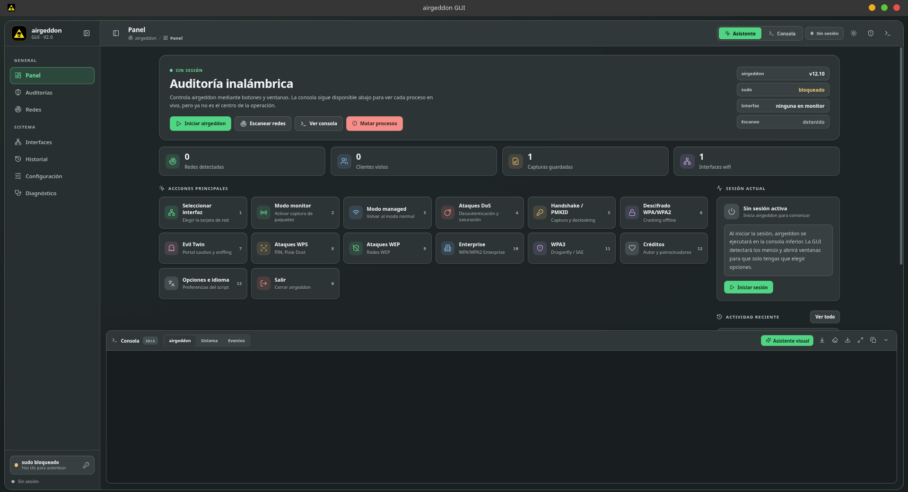
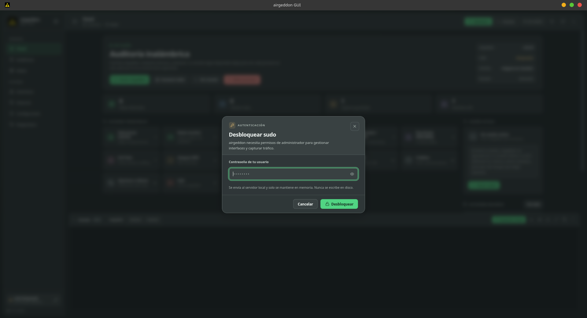
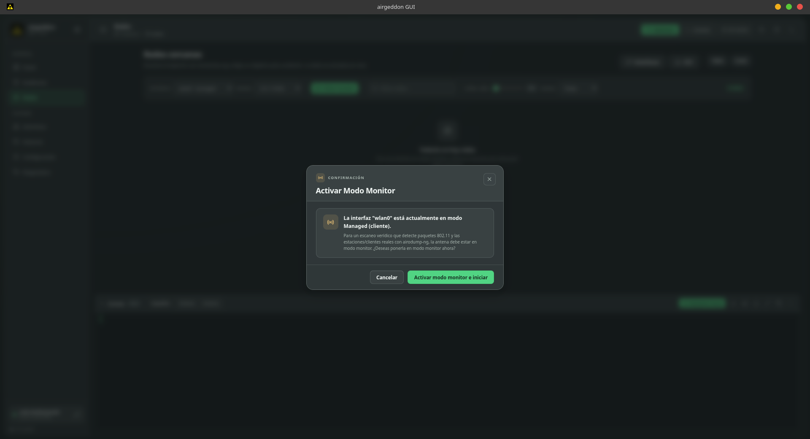
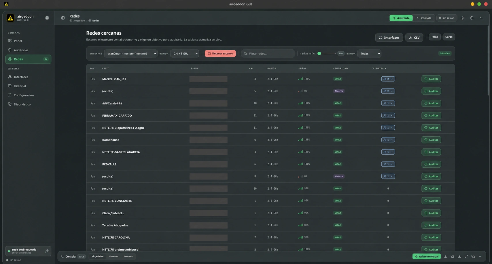

<div align="center">

# 📡 airgeddon GUI

**Tu centro de control visual para airgeddon en Linux.**

Explora redes · Gestiona interfaces · Sigue cada operación en tiempo real

[](#-requisitos)
[](#-descarga-e-instalación)
[](LICENSE)

[🚀 Instalar](#-descarga-e-instalación) · [🖼️ Capturas](#-capturas) · [🎮 Primeros pasos](#-primeros-pasos) · [🛠️ Ayuda](#-problemas-frecuentes)

</div>

---

## ⚡ ¿Para qué sirve?

**airgeddon GUI** es una interfaz gráfica para utilizar [airgeddon](https://github.com/v1s1t0r1sh3r3/airgeddon) en Linux. Permite gestionar interfaces WiFi, explorar redes y seguir las operaciones de airgeddon mediante un asistente visual y una consola integrada.

## 🧭 Funciones principales

| | Función | Qué puedes hacer |
|:--:|:--|:--|
| 🤖 | **Asistente visual** | Responder a los menús y avisos de airgeddon. |
| 📡 | **Explorador de redes** | Filtrar redes y consultar información de sus clientes. |
| 🔌 | **Interfaces WiFi** | Gestionar adaptadores y modo monitor. |
| 💻 | **Consola en vivo** | Seguir la salida de cada operación en tiempo real. |
| 🩺 | **Diagnóstico** | Comprobar herramientas y dependencias del sistema. |

## 🖼️ Capturas

### 🧭 Panel principal



### 🔐 Autenticación



### 🤖 Asistente visual



### 📡 Explorador de redes



## 🐧 Requisitos

- Linux con entorno gráfico.
- Git para descargar el proyecto.
- Node.js **22 o superior** y npm.
- Un navegador basado en Chromium, como Chromium, Chrome o Brave.
- airgeddon y las herramientas que requiera cada operación.
- Un adaptador WiFi compatible con **modo monitor** para las funciones que lo necesiten.
- Permisos de administrador mediante `sudo` para las operaciones del sistema.

> 💡 El instalador comprueba varias de estas dependencias y ofrece instalar las que faltan.

## 🚀 Descarga e instalación

Abre una terminal y ejecuta:

```bash
git clone https://github.com/sjcandy/airgeddon-gui.git
cd airgeddon-gui
./install.sh
```

Sigue las indicaciones del instalador. Podrás utilizar una instalación existente de airgeddon o descargar el proyecto original durante la configuración.

Ejecuta el instalador como tu usuario habitual; solicitará permisos mediante `sudo` cuando sean necesarios.

## ▶️ Cómo abrir la aplicación

Desde la carpeta del proyecto:

```bash
./airgeddon-gui.sh
```

También puedes buscar **airgeddon GUI** en el menú de aplicaciones después de completar la instalación.

Si airgeddon está en una ubicación que la aplicación no detecta, indica su carpeta al arrancar:

```bash
AIRGEDDON_DIR="/ruta/a/airgeddon" ./airgeddon-gui.sh
```

La ruta debe apuntar a la carpeta que contiene `airgeddon.sh`.

## 🎮 Primeros pasos

1. 🩺 Abre **Diagnóstico** para comprobar las herramientas disponibles.
2. 🔌 En **Interfaces**, selecciona tu adaptador WiFi y revisa su estado.
3. 📡 Accede a **Redes** para explorar las redes disponibles.
4. 🤖 Utiliza el **asistente visual** para seguir las operaciones de airgeddon.
5. 💻 Consulta la **consola integrada** para ver la salida y los mensajes de error.

Las funciones disponibles dependen del adaptador WiFi, sus controladores y las herramientas instaladas.

## 🔄 Actualización

En una instalación descargada con Git, puedes comprobar las actualizaciones desde **Configuración**.

También puedes actualizar desde una terminal, dentro de la carpeta del proyecto y con la aplicación cerrada:

```bash
git pull --ff-only
npm ci --omit=dev --ignore-scripts
npm rebuild node-pty
node -e "require('node-pty')"
```

Si tienes modificaciones locales, revísalas antes de actualizar.

## 🛠️ Problemas frecuentes

<details>
<summary><strong>📂 No se encuentra airgeddon</strong></summary>

Comprueba que está instalado y utiliza `AIRGEDDON_DIR` para indicar su ubicación, como se muestra en las instrucciones de inicio.

</details>

<details>
<summary><strong>🔌 El adaptador WiFi no aparece o no permite activar el modo monitor</strong></summary>

Comprueba que Linux reconoce el dispositivo y que sus controladores admiten ese modo.

</details>

<details>
<summary><strong>🧩 Faltan herramientas</strong></summary>

Consulta **Diagnóstico** y el archivo [system-requirements.txt](system-requirements.txt).

</details>

<details>
<summary><strong>💻 La aplicación no abre</strong></summary>

Ejecuta `./airgeddon-gui.sh` desde una terminal para consultar el mensaje de error. Comprueba la versión de Node.js y que tienes un navegador compatible instalado.

</details>

## 🔐 Uso autorizado

Utiliza la aplicación únicamente en redes propias o con autorización de sus responsables.

## 🤝 Créditos y licencia

Interfaz desarrollada por [sjcandy](https://github.com/sjcandy).

Basada en [airgeddon](https://github.com/v1s1t0r1sh3r3/airgeddon), desarrollado por v1s1t0r1sh3r3 y sus colaboradores.

airgeddon GUI se distribuye bajo la [licencia MIT](LICENSE). El proyecto airgeddon mantiene su propia licencia.

---

<div align="center">

📡 **airgeddon GUI** · Control visual para tus redes

[↑ Volver arriba](#-airgeddon-gui)

</div>
